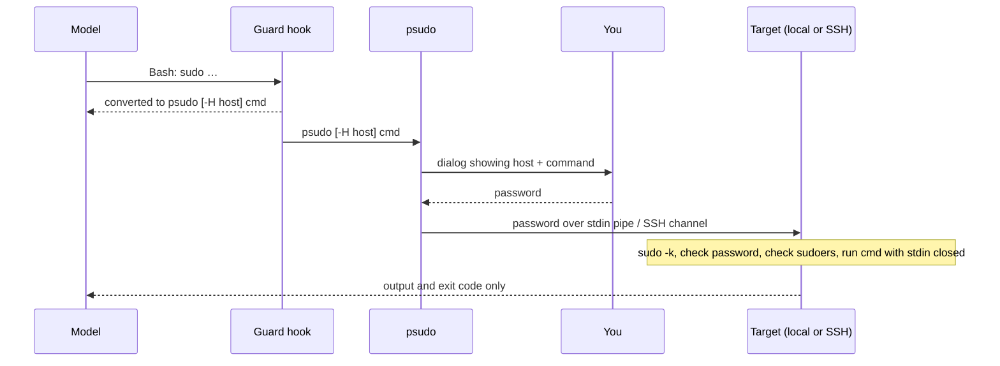

# Harness Secrets Sudo Hook

**Let an AI coding agent run root commands and use your secrets, on your machine
or over SSH, without ever seeing your password or the secret.**

AI coding agents such as **Claude Code** and **Codex** often need root: to install
a package, restart a service, or fix a server. Plain `sudo` doesn't work for
them. It needs a terminal the agent doesn't have, and the workarounds are worse:
`echo password | sudo -S`, `sshpass`, or asking you to paste the password into
the chat, all of which put your password in the model's context.

This project gives the agent one command instead, **`psudo`** (power sudo). The
agent writes the command; **you** type the password into a native desktop dialog
that shows exactly which host and which command you are authorizing. The agent
only gets the output and the exit code.

The same command hands a **secret** (an API token, a database password) to a
program that needs it. You type the value into a dialog, and harness-secrets-sudo-hook gives it to
that program only. The agent never sees it; see
[Stored secrets](#stored-secrets).

[](LICENSE)


[](https://github.com/MikeRzDev/harness-secrets-sudo-hook/stargazers)

```sh
psudo apt install nginx                        # root on this computer
psudo -H web1 systemctl restart nginx          # root on web1, over SSH
psudo -H admin@db.example.com sh -c 'journalctl -u postgres | tail -50'
psudo --secret STRIPE_API_KEY=stripe-api-key -- ./charge-report   # a secret; runs as you, not root
```

`psudo` is a single static Go binary with no runtime dependencies.

## What it helps with

**Local development.** The agent can install system packages, edit files under
`/etc`, manage services or fix permissions on your own machine. Each root
command pops up one dialog: you see `id -u` or `apt install nginx` and decide.
Cancel, and the command doesn't run.

**Remote development and operations.** The same command works on any host you
can reach with `ssh`: a VPS, a Raspberry Pi, a homelab node, a jump host. Use
`psudo -H <host> …`, where `<host>` is anything `ssh` accepts, including the
aliases in `~/.ssh/config`. The password travels inside the SSH connection,
never on a command line. Hosts that ask for more than a key at login (a one-time
code, a password, a key passphrase) work too: ssh's question appears in a
dialog, and harness-secrets-sudo-hook keeps the connection open briefly so you don't type the code
for every command. A host you log in to as root (`psudo -H root@<host>`, as on
Proxmox, which has no sudo) needs no sudo at all: the command runs directly,
with no dialog.

**Clear failures.** When something goes wrong, the agent gets one explicit line
instead of guessing: `WRONG PASSWORD`, `NOT PERMITTED` (sudoers doesn't allow
that command), `NO SUDO`, `AUTHENTICATION FAILED`, `SSH FAILED`, or "dialog cancelled". It
can report the problem instead of trying workarounds.

## How your credentials are handled

| Where | What happens |
| --- | --- |
| Typing | You type the sudo password into a native dialog (macOS `osascript`, Linux `zenity` or `kdialog`). The dialog names the host and shows the command verbatim. |
| Model context | Never. The agent only sees the command's output and exit code. |
| Command lines and environment | Never. The password is not in any process's argv or environment, locally or on the remote host. |
| In transit | Through a pipe to sudo on this computer, or through the encrypted SSH channel's stdin to sudo on the remote host. |
| The command itself | It cannot read the password: its stdin is closed. harness-secrets-sudo-hook invalidates sudo's own timestamp first, so a cached sudo ticket can't make the password leak into the command. |
| Disk | Never in a plaintext file. With the opt-in cache (off by default, see below), the OS credential store holds it. |
| Wrong password | Reported as `WRONG PASSWORD`, never retried automatically, so you don't hit the host's lockout. |
| SSH login codes | Typed into an **SSH login** dialog and passed straight to ssh. They are never stored. |

**What harness-secrets-sudo-hook can't protect against.** harness-secrets-sudo-hook keeps the password away from the
model. It can't defend against a hostile program already running under your user
account. Such a program could read the opt-in cache, or use a kept SSH
connection, while those exist. Both are off or short-lived by default; see
[Password caching](#password-caching-opt-in) and
[Hosts that need a code or password](#hosts-that-need-a-code-or-password).

## How it works in Claude Code and Codex

The installer puts `psudo` where the harness can run it and registers hooks, so
the agent knows to use `psudo` without you telling it.

| | Claude Code | Codex |
| --- | --- | --- |
| Installed at | `~/.claude/hooks/psudo` | `$CODEX_HOME/root-hook/psudo` |
| At session start | A `SessionStart` hook tells the model: root goes through `psudo`, `psudo -H` for remote hosts, never handle passwords, and what each exit code means. | The same, through Codex's `SessionStart` hook (trust it once in `/hooks`). |
| Before each command | A `PreToolUse` guard converts `sudo` to `psudo` and lets the command go ahead. It denies what it cannot convert exactly, `sshpass`, and credential-store reads that could reach harness-secrets-sudo-hook's password cache or stored secrets, and its message gives the `psudo` form to use. | Codex has no deny hook; the session context is the guidance. |
| Approvals | The harness's own approval prompt still applies to every command. harness-secrets-sudo-hook adds its dialog on top of it. | Same. |

**The guard.** A harness reads a denied command as a stop, so the guard converts
instead of denying wherever it can do so exactly: `sudo cmd` becomes `psudo cmd`,
`ssh host sudo cmd` becomes `psudo -H host cmd`, and a sudo that reads a pipe
(`echo x | sudo tee f`) becomes `psudo sh -c 'echo x | tee f'`, because psudo
closes the command's stdin. The model is told what ran. In a session that
bypasses permissions the converted command runs at once; in any other mode
Claude Code asks you first, as it would have for sudo. It still denies what it
cannot convert (another user with `-u`, `-S`, `-i`, sudo inside `sh -c` or a
script, a pipeline with `$` or `~` that would expand as root), with the `psudo`
form to use instead.

It finds `sudo` or `sshpass` where they would actually run: as a command, after
`|` or `&&`, inside `$(…)`, through wrappers such as `env`, `xargs` or
`find -exec`, or inside code given to `sh -c`, `ssh`, `python3 -c` and the like.
The word as plain text is fine for data tools (`cat`, `tee`, `echo`, `grep`,
`git commit -m`, …), so writing notes or commit messages that mention sudo isn't
blocked. This project's own name, `harness-secrets-sudo-hook`, is fine anywhere,
so a path into a checkout or a link to the repository isn't blocked either. If
it can't tell, it denies. It is best effort by design. The real
backstop is that sudo without a terminal and without your password fails on its
own.



Tested end to end with headless Claude Code (Sonnet 5.5) and Codex (GPT-6.1-sol)
sessions. Without being told about `psudo`, both used it for root on this computer
and over SSH (including an SSH login dialog), and both reported cancels and
failures accurately.

## Install

### Homebrew (macOS and Linux)

```sh
brew install MikeRzDev/tap/harness-secrets-sudo-hook
psudo --install=claude-code     # and/or
psudo --install=codex
```

The formula has the project's name; the command it installs is `psudo`. The
installer copies `psudo` into the harness's hook folder, so after
`brew upgrade harness-secrets-sudo-hook` run `psudo --install=…` again to update
that copy.

Up to v0.1.0 the formula was called `psudo`. If you installed that one, run
`brew uninstall psudo` first.

### Go

```sh
go install github.com/MikeRzDev/harness-secrets-sudo-hook/cmd/psudo@latest
"$(go env GOPATH)"/bin/psudo --install=claude-code     # and/or --install=codex
```

Pin a version with `@v0.2.0` instead of `@latest`; v0.2.0 is the first version
under this module path. Go builds it from source (Go 1.22+), so `go install`
works on any platform Go targets.

### From a release

Download the archive for your platform from
[Releases](https://github.com/MikeRzDev/harness-secrets-sudo-hook/releases), check it
against `SHA256SUMS`, and run the installer for your harness:

```sh
tar -xzf psudo_<version>_<os>_<arch>.tar.gz
cd psudo_<version>_<os>_<arch>
./psudo --install=claude-code     # and/or
./psudo --install=codex
```

The binaries are not signed. If macOS blocks a binary downloaded with a browser,
run `xattr -d com.apple.quarantine psudo` first.

### From source

Requires Go 1.22+.

```sh
git clone https://github.com/MikeRzDev/harness-secrets-sudo-hook.git
cd harness-secrets-sudo-hook
make install-claude-code     # and/or: make install-codex
```

### Requirements

| | macOS | Linux |
| --- | --- | --- |
| Dialog | built-in `osascript` (test builds only: `/Applications/psudo.app` via `make install-test-app`, see the spec §6.2) | `zenity`, `kdialog`, or `ssh-askpass` with a logged-in desktop |
| Remote hosts | OpenSSH 8.4+ (built in) | same |
| Password cache (opt-in) | login Keychain (built-in) | `secret-tool` (`libsecret-tools`) and a Secret Service provider such as GNOME Keyring |

Restart the harness after installing. The harness guides cover each installer
in detail: [Claude Code](claude-code/README.md) and [Codex](codex/README.md).

## Usage

```
psudo [-H <host>] [--] <command> [args...]
```

- With no `-H`, the command runs on this computer.
- The command is an argument vector, not a shell string: the target receives exactly the same arguments. For pipelines or `cd`, pass a shell: `psudo sh -c '…'`.
- stdout and stderr pass through unchanged. The command's stdin is closed, so it can't prompt.
- `psudo` takes no sudo options. Use `psudo runuser -u postgres -- psql` or `sh -c`.

| Exit code | Meaning |
| --- | --- |
| the command's own | The command ran |
| 2 | Usage error (for example an invalid host) |
| 250 | No dialog available, or the cache settings or credential store are unusable |
| 251 | You cancelled the dialog, or it timed out (90 s) |
| 252 | Authentication failed on the target; the command did not run |
| 255 | SSH connection or login failed; no sudo password was requested |

Every failure harness-secrets-sudo-hook itself causes prints one line starting with `psudo:`. For
exit 252 it names the cause:

| Message | Meaning |
| --- | --- |
| `psudo: WRONG PASSWORD: …` | sudo rejected the password (a stale cached one is cleared) |
| `psudo: NOT PERMITTED: …` | sudoers doesn't allow this account to run that exact command (checked with `sudo -l` before anything runs) |
| `psudo: NO SUDO: …` | the target has no sudo and the login account is not root; `-H root@<host>` works where root may log in |
| `psudo: AUTHENTICATION FAILED: …` | any other refusal, for example `requiretty`; sudo's own message is shown above it |

### Hosts that need a code or password

Some hosts ask for more than a key at SSH login. Nothing has to be set up per
host:

1. harness-secrets-sudo-hook first tries your `~/.ssh/config` with keys only.
2. If that fails, harness-secrets-sudo-hook logs in itself. Each question ssh asks (for example
   `Verification code:`) appears in a dialog titled **SSH login**, naming the
   host. The answer goes straight to ssh and is never stored.
3. harness-secrets-sudo-hook keeps that connection for **30 minutes after its last use**, so later
   commands to that host only show the sudo dialog. `psudo --ssh-logout`
   closes it now.

A wrong or cancelled login exits 255 before any sudo dialog. If the host key is
unknown, the login is refused: connect once with `ssh` in a terminal to accept
it.

**What the kept connection allows:** while it is open, any program running as
you, including the harness, can run commands on that host as the SSH user
without the code. If that account has passwordless sudo, that means root
without a dialog. It's the same trade-off as `ControlPersist` in your own ssh
config. Run `psudo --ssh-logout` when you're done.

### Touch ID on macOS

If sudo on your Mac accepts Touch ID, psudo uses it for commands on this
computer. You get the system's Touch ID sheet instead of psudo's password
dialog, and the sheet's **Use Password…** button takes your password as well.
Cancelling the sheet cancels the command (exit 251). psudo then shows no
password dialog of its own and sends no password, and it doesn't use the
password cache. Commands on SSH hosts (`-H`) still use the password dialog:
the sensor is on this Mac.

To turn on Touch ID for sudo, create `/etc/pam.d/sudo_local` (Apple's
template says the file survives system updates) with the line that
`/etc/pam.d/sudo_local.template` has commented out:

```text
auth       sufficient     pam_tid.so
```

psudo checks `/etc/pam.d/sudo_local` and `/etc/pam.d/sudo` for that line on
every command. This turns on Touch ID for every sudo on the Mac, the one you
type in Terminal included. The sheet names sudo, not the command: the command
is what the harness's approval prompt shows.

## Password caching (opt-in)

**Off by default**: every command shows the dialog. You can let local commands
reuse a password for a fixed window (two hours) by setting `"enabled": true` in
`~/.config/harness-root-hook/config.json`. Remote hosts are never cached.

Read this first: the cached password lives in macOS Keychain or the Linux Secret
Service, and any program running as you can read it there, including the
agent's own shell. The Claude Code guard denies commands that read it, but a
guard can be worked around, and Codex has no deny hook. See
[password caching](CACHE.md) for details.

## Stored secrets

harness-secrets-sudo-hook can also hand a stored secret (an API token, a database password, a
kubeconfig) to a command, without the agent ever seeing the value. The command
runs **as you, not as root**. The full design is in [docs/secrets.md](docs/secrets.md).

**You only answer dialogs.** The agent learns about `psudo` from the session
context and starts everything itself:

```sh
psudo --secret STRIPE_API_KEY=stripe-api-key -- ./charge-report
```

- **First use of a secret:** a **Secret needed** dialog shows the command and
  asks you for the value. Type or paste it. A second dialog asks where to keep
  it (see below); press Return and it is kept **for this session only**. harness-secrets-sudo-hook
  also adds a rule to `config.json` that lets only this program use it (on this
  host), and runs the command.
- **A stored secret used by a program for the first time:** one **Allow and add
  rule** dialog adds the rule.
- **Later uses: no dialog.** harness-secrets-sudo-hook has the value and the rule covers the
  program, so the command just runs. A program the rule does not list is
  refused. harness-secrets-sudo-hook only opens a dialog when it needs something from you.
- **The program must stay the one you allowed.** harness-secrets-sudo-hook remembers the SHA-256
  of the program file and asks again if the file is a different one later:
  after an update, or after someone edited or replaced it.
- **Interpreters ask every time.** `python3`, `node`, `perl` and the like run
  whatever code they are given, so a rule harness-secrets-sudo-hook adds for one keeps the
  Deny / Allow once dialog, which shows the whole command. Set
  `"confirm": false` in the rule to turn that off.
- **Values already in a git-ignored `.env.local` or `.env`:** no dialog and no
  rule at all; the agent could read that file anyway. Such a value cannot be
  combined with a stored secret in one command, because the agent can write
  the file.

**Where a secret is kept.** Nothing outlives the session unless you choose it:

| Choice | Kept | Notes |
| --- | --- | --- |
| **This session only** (default) | Until this Claude Code or Codex session ends | A new session asks again. Another session cannot use it. |
| **Save in `.env.local`** (or `.env`) | In the project's env file | Offered only when the project has one that **git ignores**. It is plain text, so the agent can read it; this is for projects that already work that way. Saved as the name in upper case: `stripe-api-key` is `STRIPE_API_KEY`. |
| **Save in Keychain** (Linux: keyring) | In the OS credential store, for every project | Until you delete it with `psudo --secret-delete`. |

harness-secrets-sudo-hook also finds values that are already in a git-ignored `.env.local` or `.env`,
under the same variable name. A value in the Keychain wins over one in an env
file, because the agent can write the file.

**Optional: manage secrets yourself.** You don't need any of this for the
flow above:

```sh
psudo --secret-set=github-token                          # type the value into a dialog; kept in the Keychain
psudo --secret-import=k8s-staging < ~/.kube/staging.yaml # multi-line values; asks before storing
psudo --secret-list            # names and rules, never values
psudo --secret-delete=github-token
```

**Rules** live in `~/.config/harness-root-hook/config.json`. harness-secrets-sudo-hook writes
them for you. Edit them to widen or narrow access:

```json
{
  "cache": { "enabled": false, "ttl_seconds": 7200 },
  "secrets": {
    "github-token": { "commands": ["gh"], "vars": ["GH_TOKEN"] },
    "k8s-staging":  { "commands": ["kubectl"], "vars": ["KUBECONFIG"] },
    "prod-db":      { "commands": ["psql"], "vars": ["PGPASSWORD"], "local": false, "ssh_hosts": ["prod"] }
  }
}
```

| Field | Default | Meaning |
| --- | --- | --- |
| `commands` | required | Programs that may receive the secret: a name found in the system directories (`/usr/bin`, `/opt/homebrew/bin`, …) or an absolute path. Shells, `env`, `printenv`, `echo`, `cat`, `ssh`, `sudo` and programs that run other programs are refused. |
| `vars` | the secret's own name | Variables the secret may be put in. harness-secrets-sudo-hook fills this in from the first use. Without it, only the name in upper case (`github-token` is `GITHUB_TOKEN`). |
| `local` | `true` | Usable on this computer |
| `ssh_hosts` | `[]` | Hosts (as given to `-H`) where it is usable |
| `confirm` | `false` | `true` asks before each use (Deny / Allow once). By default an allowed program gets the secret without a dialog. |
| `remember_seconds` | `0` | Offer "Allow for N min" for exactly the same command (max 86400) |

**Each SSH host has its own secrets.** Two hosts can use the same secret name with different values. psudo tells them apart by the `-H` argument as given. If the rule for `ollama-api-key` lists only `maxwell-bob`, then `psudo -H android-dev --secret OLLAMA_API_KEY=ollama-api-key …` is a request for a different secret, `ollama-api-key@android-dev`. psudo asks you for its value and adds a rule under that key, which has no `local` or `ssh_hosts` field. To share one value between hosts on purpose, list them all in the plain rule's `ssh_hosts`. See [docs/secrets.md](docs/secrets.md) §5.3.

**More forms the agent uses:**

```sh
psudo --secret GH_TOKEN=github-token -- gh api user
psudo --secret-file KUBECONFIG=k8s-staging -- kubectl get pods
psudo -H prod --secret PGPASSWORD=prod-db -- psql -h localhost -c 'select 1'
```

When harness-secrets-sudo-hook does open a dialog, it shows the secrets, the host, the folder and
the exact command. In the dialogs that ask for a decision, **the refusal is the
default button** on macOS and with zenity, so pressing Return refuses.
(kdialog has no way to choose the default button, so check which button has the
focus there.) The command then gets a fixed environment: your account's own
`HOME`, `USER` and `LOGNAME` (never the caller's), locale, `SSH_AUTH_SOCK`,
`PATH` set to the system directories, and the secrets. The `XDG_*` directories
are not passed, so the caller cannot point the program at a config folder of its
own. `--secret-file` writes a 0600 file that is deleted when the command ends.
Secrets are replaced with `[REDACTED:<name>]` in the command's output.

**Rule changes need your approval.** The agent can edit `config.json` too. So
harness-secrets-sudo-hook uses the rules only after you approve them in a dialog, and any edit to
them asks again. A file with no rules asks nothing.
Rules harness-secrets-sudo-hook adds through a Secret needed or Allow and add rule dialog count as
approved by that dialog.

**What this does not stop.** An allowed program can still send a secret it
receives anywhere it likes, or run code it finds in the folder: git hooks,
`.npmrc`, Makefiles. Since harness-secrets-sudo-hook does not ask before each use, the rule is the
only gate: an allowed program gets the secret whenever the agent runs it. For
tools like these, set `"confirm": true` in the rule to be asked every time. For `curl`, store the whole header line
(`Authorization: Bearer …`) and use
`--secret-file H=name -- curl -H @"$H" …` (with `curl` in the rule). On Codex,
nothing blocks the agent from reading the Keychain directly, since Codex has no
deny hook.

| Exit code | Meaning |
| --- | --- |
| 251 | You denied the request or the rule change, or the dialog timed out |
| 253 | Not allowed: the program can never receive secrets (a shell, `env`, …), or the command or host isn't in the secret's rule |
| 254 | The credential store is unavailable, or the secret couldn't be delivered on the host |

## Limitations

- Commands that need a terminal or their own input (for example a tool that reads a secret with the echo off) can't run through `psudo`. Run those yourself.
- The remote login shell must be POSIX-compatible (sh, bash, dash, zsh, ksh). Targets that set `requiretty` are unsupported. Targets that keep no sudo timestamp must allow `/bin/sh` in sudoers.
- Scripts that call `sudo` internally work only when the whole script is the `psudo` command.
- The guard is best effort (see above). harness-secrets-sudo-hook does not defend against a hostile program running as your user.

## Uninstall

```sh
~/.claude/hooks/psudo --uninstall=claude-code
"${CODEX_HOME:-$HOME/.codex}/root-hook/psudo" --uninstall=codex
```

## Development

```sh
make test       # go vet + unit tests (fake sudo, ssh and dialogs; no real password or root)
make build      # bin/psudo
make dist       # cross-compiled archives + SHA256SUMS in dist/
make release VERSION=v1.2.3   # GitHub release from dist/ + Homebrew tap update; run deliberately, no CI
```

The local and remote transports run through the same test suite. It checks that
the password never appears in output, argv or environment, and that every exit
code and hook decision matches the spec. The full design is in
[docs/harness-secrets-sudo-hook.md](docs/harness-secrets-sudo-hook.md).

**Earlier names.** The project was called `harness-root-hook` and then
`harness-psudo-hook` (Power Sudo Harness Hook), and its Homebrew formula was
`psudo`. The command is still `psudo`. Names on disk (the config directory, credential-store entries, launchd task,
`HARNESS_ROOT_HOOK_CONFIG`) keep `harness-root-hook`, so existing installs keep
working.

## License

[MIT](LICENSE).
