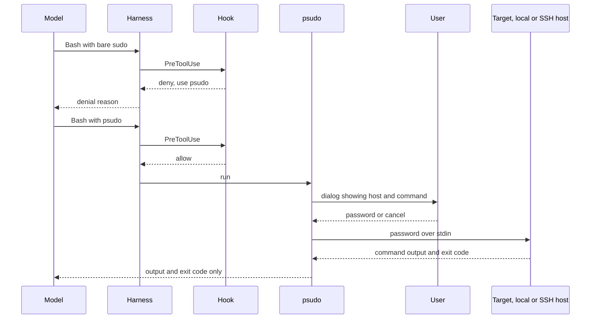

# Harness Secrets Sudo Hook (`psudo`): secure sudo credential prompt for agent harnesses

Status: implemented (v1), see "Implementation decisions" at the end
Date: 2026-11-18

## 1. Purpose

Let an AI coding harness (Claude Code first) run privileged commands, on the local machine or on a host reached over SSH, without the sudo password ever being visible to the model.

The human types the password into a native dialog on the machine where the harness runs. The harness sees only the command's output and exit code.

## 2. Scope

In scope:

- Privileged commands on the local machine.
- Privileged commands on a remote host over SSH (key-based auth; see §11.6 for interactive logins).
- macOS and Linux desktops as the machine where the harness runs.
- Enforcement so the model cannot use plain `sudo` instead.

Out of scope (v1):

- Harness running on a headless machine with no display.
- Commands that need their own stdin.
- Credential caching across invocations (every invocation prompts).
- Windows.
- SSH password authentication (the tool never prompts for SSH credentials).

## 3. Security invariants

These are the requirements that matter most. Any implementation choice that breaks one is wrong.

1. **The password never enters model context.** It must not appear in tool input, tool output, stderr, the transcript, or logs.
2. **The password never appears in a command line or environment variable**, locally or remotely. It travels only over a pipe (local) or the SSH channel's stdin (remote).
3. **The password is never written to disk** and is discarded as soon as it has been handed to sudo.
4. **The privileged command can never read the password.** Its stdin is closed or empty.
5. **The human sees what they authorize.** The dialog shows the target host and the full command verbatim.
6. **Model-controlled text is data, never code.** Host names and command text shown in the dialog must be passed as arguments, not interpolated into script source.
7. **Failure is closed.** If anything in the path fails, the privileged command does not run.

## 4. Components

| Component | Role | Runs where |
|---|---|---|
| `psudo` CLI | Single entry point for privileged commands | Harness machine |
| Prompt provider | Shows the dialog, returns the password | Harness machine |
| Enforcement hook | Denies bare `sudo`, points the model to `psudo` | Harness (PreToolUse) |
| Skill (optional) | One paragraph telling the model the convention | Harness |

The hook is the control. The skill only saves a denied turn and carries no security weight.

## 5. Flow



## 6. Contracts

### 6.1 CLI

```
psudo [-H <host>] [--] <command> [args...]
```

- Without `-H`, the target is the local machine.
- `<host>` is anything `ssh` accepts as a destination, including aliases from the user's SSH config.
- `<command> [args...]` is an argument vector, not a shell string. The target must receive exactly the same arguments. A caller who wants a pipeline passes an explicit shell, e.g. `psudo sh -c '...'`.
- stdout and stderr of the privileged command pass through unchanged.
- Local and remote targets use the same execution sequence (6.3); only the transport differs.

Exit codes:

| Code | Meaning |
|---|---|
| command's own code | The privileged command ran |
| 250 | No prompt provider available (no display) |
| 251 | User cancelled or the dialog timed out |
| 252 | sudo rejected the password or the user is not permitted |
| 255 | SSH transport or SSH authentication failure |

Every failure that originates in `psudo` writes one line to stderr prefixed with `psudo:` so the model can tell it apart from the command's own errors. These messages never include the password.

### 6.2 Prompt provider

- Input: the target host label and the command text.
- Output: the password on stdout, exit 0. Non-zero exit means cancel.
- Hidden text entry.
- Has a timeout shorter than the harness's command timeout; on expiry it behaves as cancel.
- Backends: native dialog on macOS, a standard password dialog on Linux desktops.
- Replaceable, so a different provider (for example a phone approval) can be added later without changing the CLI.

### 6.3 Execution sequence on the target

Three distinct steps, in this order:

1. **Invalidate** any cached sudo credential.
2. **Validate** using the password read from stdin, with sudo's own prompt text suppressed.
3. **Execute** the command non-interactively with stdin closed.

Why this matters:

- Without step 1, a cached credential makes sudo skip reading stdin, and the password would flow into the command as input (violates invariant 4).
- Keeping steps 2 and 3 separate lets `psudo` tell a rejected password (252) apart from a command that exits non-zero.

For remote targets, SSH runs in batch mode so it can never fall back to prompting.

### 6.4 Enforcement hook

- Event: PreToolUse, tool: Bash.
- Rule: deny when the command contains `sudo` as a standalone word anywhere, or contains `sshpass`. `psudo` itself must not match.
- Denial message, returned to the model:

  > Use `psudo <command>` (local) or `psudo -H <host> <command>` (remote). Never ask for or handle the password.

Decision matrix:

| Command | Decision |
|---|---|
| `sudo apt install x` | deny |
| `ssh host sudo systemctl restart nginx` | deny |
| `echo ... \| sudo -S ...` | deny |
| `sshpass -p ... ssh host` | deny |
| `psudo apt install x` | allow |
| `psudo -H host systemctl restart nginx` | allow |
| `psudo ls && sudo rm x` | deny |
| `cat /etc/sudoers` | allow |

**Departure: conversion instead of denial.** A harness reads a denied tool call as a stop, so the shipped hook converts every `sudo` it can convert exactly and returns the result as `updatedInput`: `sudo [-n -E -H -k -u root -p …] cmd` → `psudo cmd`; `ssh host sudo cmd` (plain words, no ssh options) → `psudo -H host cmd`; a sudo that reads stdin (a pipe, `<`) → `psudo sh -c '<pipeline>'`, unless the pipeline has `$`, `` ` `` or `~`, which would expand as root. The converted command is judged again and used only if it passes. The decision is `allow` when the session bypasses permissions and `ask` otherwise, and `additionalContext` tells the model what ran. The rows above marked deny that convert (`sudo apt install x`, `ssh host sudo …`, `psudo ls && sudo rm x`) therefore run through psudo; `sudo -S`, another user, `sudo -i`/`-s`, sudo inside `sh -c` or a script, and `sshpass` are still denied, with a message that tells the model to go on through psudo.

The hook is best effort by design. The backstop is that sudo without a terminal and without a password fails on its own, so a command that slips past the pattern still fails closed.

### 6.5 Skill (optional)

A short instruction: privileged commands go through `psudo`; never request, echo, or store a password in conversation.

## 7. Failure behaviour

| Situation | Result |
|---|---|
| User cancels the dialog | 251, command not run |
| Dialog times out | 251, command not run |
| Wrong password | 252, command not run, no automatic retry |
| No display available | 250, command not run |
| SSH unreachable or key rejected | 255, no dialog shown if detectable beforehand |
| User not in sudoers on the target | 252 |
| No sudo on the target, account not root | 252 (`NO SUDO`) |
| Account is root on the target | Runs directly, no dialog |
| Privileged command fails | Its own exit code and stderr |

No automatic retries on a wrong password, since repeated failures count against the target's lockout policy.

## 8. Known limitations

- Scripts that call `sudo` internally do not work unless the whole script is run as the `psudo` command.
- Targets configured to require a terminal for sudo are unsupported.
- The hook reads the command like the shell does, so the word as data (a heredoc written to a file, a commit message, a grep pattern) is allowed. A computed command name or an unparseable command falls back to the plain word match. See §11.10.
- One prompt per invocation can be tedious for long sessions (see open questions).

## 9. Acceptance criteria

1. With a known test password, a full run leaves no trace of it in the harness transcript, process listings on either machine, shell history, or any log file.
2. With a valid cached sudo credential on the target, a command that echoes its stdin outputs nothing.
3. A command containing quotes and script metacharacters is displayed verbatim in the dialog and does not alter the dialog's behaviour.
4. Arguments containing spaces and quotes arrive on a remote target as the same argument vector.
5. Each row in the failure table (7) produces the stated exit code, and the command does not run where stated.
6. Each row in the hook matrix (6.4) produces the stated decision.
7. The local and remote paths pass the same test suite.

## 10. Open questions

1. **Session unlock:** should there be an opt-in mode where one approval covers several commands for a short window? This trades invariant 5 for convenience.
2. **Headless harness:** which provider to add first, a remote approval channel or a documented scoped `NOPASSWD` fallback?
3. **Audit log:** should `psudo` record timestamp, host, command, and outcome locally?
4. **Other harnesses:** should the hook be specified generically so the same policy can be ported to Hermes or a custom harness?

## 11. Implementation decisions

The implementation is the Go binary in `cmd/psudo`. It differs from or extends the draft above in these places:

1. **Local password cache: opt-in (departs from §2 and invariant 3 only when turned on).** Off by default, which matches the draft. With `"enabled": true` in `~/.config/harness-root-hook/config.json`, local `psudo` keeps a fixed window (`ttl_seconds`, 7200), stored only in macOS Keychain or the Linux Secret Service, never in a plaintext file. While a cached password is valid, no dialog appears, so invariant 5 then rests on the harness's own approval prompt.
   - **It also weakens invariant 1.** Those stores return the password to any process running as the user: on macOS through `/usr/bin/security`, which the entry trusts, and on Linux through an unlocked Secret Service. That includes the harness's shell. The Claude Code guard denies `security` or `secret-tool` commands on `harness-root-hook` entries (§11.10). This is why the cache is off by default.
   - Remote hosts are never cached; every `psudo -H` prompts.
2. **A rejected cached password** clears the entry and exits 252 without re-prompting. The next invocation shows the dialog.
3. **Execution script.** Both transports run the same fixed `/bin/sh` script with the sudo path, a random marker and the argument vector as positional parameters.
   - When the account is already root (`id -u` is 0, as with `-H root@<host>` on Proxmox, which has no sudo), the script prints `<marker> root` and runs the command itself with stdin closed. No sudo runs, no dialog is shown and nothing is sent: a root login already grants root, so asking would add nothing.
   - Otherwise the script first asks sudoers which rule decides this exact command (`sudo -n -l -l -- cmd`). When that rule is NOPASSWD (`Options: !authenticate`), it prints `<marker> nopw` and runs the command with `sudo -n --`: no dialog is shown and nothing is sent. This covers an account with a NOPASSWD rule next to one that needs a password (the `sudo` group), where `sudo -v` asks for a password because of `verifypw=all`. `sudo -n` still decides, so a misread listing can only make the command fail. A sudo whose listing does not name the matching rule takes the password path.
   - Otherwise the script prints `<marker> ready`, and only then does harness-secrets-sudo-hook show the password dialog. It sends the password only after that line, and gives up after 30 seconds without it. A target that is not running the script (a forced command, an appliance shell, a login shell that is not a POSIX shell, a startup file that reads stdin) therefore never receives the password and cannot echo it into the output the model reads (invariant 1).
   - An empty password (OK on an empty field) is a password like any other. If stdin closes without a whole line (a cancelled dialog), the script exits without running anything.
   - The script reads the password line into a shell variable that is never exported and never in any process's argv. It then closes stdin (`exec </dev/null`). Each sudo that needs the password gets it through a pipe from the `printf` builtin.
   - Steps: `sudo -k`, then `sudo -S -p '' -v` (with `LC_ALL=C`, so its refusal message can be classified).
   - Before the command runs, the script prints one status line, `<marker> <status>`, where status is `ok`, `badpw`, `denied`, `authfail`, `nosudo` or `noshell`. harness-secrets-sudo-hook turns these into the explicit messages `WRONG PASSWORD`, `NOT PERMITTED`, `NO SUDO` (no sudo on the target and the account is not root) and `AUTHENTICATION FAILED`, all with exit 252.
   - When `sudo -n -v` shows the target kept the timestamp, the exact command runs with `sudo -n --`, so sudoers rules and logs see the real command.
   - Some targets don't carry the timestamp between separate sudo invocations, for example with `timestamp_timeout=0`. Before this fallback, `-v` succeeded but `sudo -n` failed with "a password is required" and exit 1. Now the command is authenticated inline with `sudo -k -S -- /bin/sh -c 'exec "$@" </dev/null' psudo cmd…`, after first checking with `sudo -l` that sudoers allows it (`noshell` otherwise).
4. **Fixed executables.** `sudo`, `ssh`, `secret-tool` and the dialog programs come from fixed system directories, never from `PATH`. The local shell gets a minimal environment, and `ssh` loses `LD_*`, `DYLD_*` and `SSH_ASKPASS*`. `HOME`, `USER` and `LOGNAME` in that environment come from the account database, not from the caller: where sudo keeps `HOME` (as on macOS), the root command would otherwise read its dotfiles from a folder the caller chose, which the dialog does not show.
   - The same holds for every program harness-secrets-sudo-hook runs for itself: `security`, `secret-tool`, `launchctl` and the dialog programs. macOS's `security` finds the keychain through `HOME`. Started with a `HOME` the caller chose (`HOME=/elsewhere psudo …`), it finds no keychain, and macOS then offers the user a **Reset To Defaults** of the default keychain. These programs also lose `CFFIXED_USER_HOME`, `LD_*` and `DYLD_*`. On Linux they use the user's standard session bus (`/run/user/<uid>/bus`) when it exists, not the address in `DBUS_SESSION_BUS_ADDRESS`, so a caller cannot have harness-secrets-sudo-hook store a value in, or read approvals from, a secret service of its own.
5. **Host validation.** Hosts that are empty, start with `-` or contain whitespace, control characters, or invisible or direction-changing characters exit 2, and `ssh` always gets `--` before the host. In the command shown in the dialog, such characters appear as `\u{…}` escapes; newlines and tabs stay as they are.
6. **Pre-flight.** `ssh -T -o BatchMode=yes -- host true` runs before the dialog, so an unreachable host exits 255 without asking for a sudo password.
   - **Interactive SSH login (departs from §2, "SSH password authentication").** When the key-only pre-flight fails, harness-secrets-sudo-hook logs in itself: `ssh -o ControlMaster=yes -o ControlPath=<dir>/%C -o ControlPersist=1800 -o NumberOfPasswordPrompts=1 -- host true`, with `SSH_ASKPASS` set to harness-secrets-sudo-hook and `SSH_ASKPASS_REQUIRE=force`.
   - In that mode (`PSUDO_SSH_ASKPASS_HOST` set), harness-secrets-sudo-hook shows each of ssh's prompts in an "SSH login" dialog with the host, and writes the answer to ssh's pipe. Confirmation prompts, such as an unknown host key, are refused.
   - The command itself still runs with `BatchMode=yes` over that connection (`ControlMaster=no`), so the sudo password's path is unchanged. Before anything else, harness-secrets-sudo-hook checks `ssh -O check` for a connection it already keeps, which is how a TOTP host prompts once per 30 idle minutes and not on every command.
   - `<dir>` is `/tmp/psudo-<uid>` (Linux: `$XDG_RUNTIME_DIR/psudo`), mode 0700 and owned by the user, or sharing is off. `--ssh-logout` closes every kept connection.
   - This works for any login method ssh can prompt for (password, keyboard-interactive codes, key passphrases), without per-host configuration.
7. **Dialog timeout.** 90 seconds, below Claude Code's 120-second default command timeout.
8. **Codex** gets `psudo` through its SessionStart context instead of a deny hook, matching the previous Codex integration, which installed no permission hooks.
9. **Exit code 2** is used for usage errors, which the draft did not cover. Exit 250 also covers an invalid cache config file or an unavailable credential store (fail closed).
10. **The hook parses the command (refines §6.4).** Matching the word anywhere denied ordinary work: heredocs written to files, commit messages, grep patterns. The hook now tokenizes the command like a POSIX shell: quotes, escapes, comments, heredocs, `$(…)`, backticks and redirections.
    - It denies when `sudo` or `sshpass` is the program a simple command runs. That holds after assignments, reserved words such as `if`, `then`, `do` and `!`, and wrappers such as `env`, `xargs`, `nohup`, `time`, `exec` and `timeout`.
    - It also denies when either word appears inside code: an argument, heredoc or here-string of `sh`, `bash`, `zsh`, `ssh`, `eval` or `su`, data piped into one of those, or a command substitution. That includes unquoted heredoc bodies.
    - Interpreters (python, perl, ruby, node, awk, osascript and others) count as code carriers too.
    - The word as text is allowed only for known data programs: cat, tee, echo, printf, grep/rg, git (not with -c), gh (not alias), and file tools such as ls, cp, mv, mkdir and jq. Every other program is judged on its full text, so an unknown program fails closed.
    - `psudo`'s own arguments are trusted only when the command word resolves to the installed binary. A program merely named `psudo` is judged like any other.
    - A computed program name (`$cmd`) or a command it cannot parse falls back to the plain word match, so failure still denies.
    - The project's own name, `harness-secrets-sudo-hook`, holds the word between dashes. The plain word match skips exactly that name, so a path into a checkout (`cd …/harness-secrets-sudo-hook`), `git clone` and `go install` of the repository are allowed. A command word called `sudo` is denied wherever it lives, also in a folder of that name.
    - It also denies `security` or `secret-tool` commands that name a `harness-root-hook` entry (§11.1), or that print a secret from any entry (see [secrets.md](secrets.md) §7.1). This holds behind a wrapper and its values (`timeout 5 security …`) and for the command given to harness-secrets-sudo-hook itself.
    - It remains best effort: §6.4's backstop still applies.

Additional limitations:

- The remote login shell must be POSIX-compatible (sh, bash, dash, zsh, ksh). Its startup files run with the SSH channel's stdin, but harness-secrets-sudo-hook writes nothing to it until the script has reported `ready`, so they cannot pick up the password by accident. A startup file changed on purpose to imitate the script still can; see the last point.
- On a target that keeps no sudo timestamp, the command runs through `/bin/sh` under sudo. sudoers must allow `/bin/sh` there, and sudo's logs show the shell wrapper.
- Commands that need a terminal (for example a tool that reads a secret with the echo off) or their own stdin cannot run through `psudo`.
- `psudo` accepts no sudo options. Use `psudo runuser -u <user> -- …` or `psudo sh -c '…'`.
- A model that can write the user's files can tamper with the installed binary or with the remote user's shell startup files. harness-secrets-sudo-hook keeps the password out of the model's context and off command lines. It is not a defence against a hostile process running as the same user.
